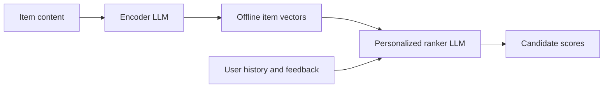

<h1 align="center">DuoLM</h1>

<p align="center">
  <strong>Fast and Effective Personalized Recommendation with Language Models</strong>
</p>

<p align="center">
  <a href="https://arxiv.org/abs/2610.24481"></a>
  <a href="https://huggingface.co/hulehule/DuoLM-Books"></a>
  <a href="https://huggingface.co/hulehule/DuoLM-Video-Games"></a>
  <a href="LICENSE"></a>
</p>

<p align="center">
  <a href="docs/data.md">Data</a> ·
  <a href="docs/training.md">Training &amp; Evaluation</a> ·
  <a href="docs/serving.md">Efficient Serving</a> ·
  <a href="docs/ablations.md">Ablations</a> ·
  <a href="docs/checkpoints.md">Checkpoint Guide</a>
</p>

## 🔥 Update

- [2026.10.21] DuoLM model weights are released on Hugging Face: [Books](https://huggingface.co/hulehule/DuoLM-Books) and [Video Games](https://huggingface.co/hulehule/DuoLM-Video-Games)!
- [2026.10.21] DuoLM code is released! See [Getting started](#getting-started) for training, evaluation, and efficient serving.

## Overview

DuoLM makes personalized recommendation more efficient by **jointly training an
item encoder and an LLM ranker** with recommendation supervision and teacher
distillation. It pairs compact, reusable item representations with a serving
runtime that shares history computation across candidates, preserving
recommendation quality while reducing online computation.



## Acknowledgment

We thank UC Irvine, Google DeepMind, and Oracle for their support.

<p align="center">
  <a href="https://uci.edu/"><picture><source media="(prefers-color-scheme: dark)" srcset="assets/logos/uci-light.png"></picture></a>
  <a href="https://deepmind.google/"><picture><source media="(prefers-color-scheme: dark)" srcset="assets/logos/google-deepmind-wordmark-light.svg"></picture></a>
  <a href="https://www.oracle.com/"></a>
</p>

## What's included

- Data preparation, training, and evaluation for Books and Video Games recommendation.
- Pretrained checkpoints and an inference guide for scoring new items.
- Efficient serving with offline item encoding, shared history, and CUDA Graphs.
- Model and runtime ablations from the paper.

## Released checkpoints

| Domain | Model |
| --- | --- |
| Books | [DuoLM-Books](https://huggingface.co/hulehule/DuoLM-Books) |
| Video Games | [DuoLM-Video-Games](https://huggingface.co/hulehule/DuoLM-Video-Games) |

Both checkpoints include model weights, tokenizers, and configs. See the
[checkpoint guide](docs/checkpoints.md) to get started.

## Getting started

Use Python 3.11 or 3.12. Training requires a CUDA GPU with BF16 support;
synthetic correctness tests run on CPU without downloading model weights.

```bash
git clone https://github.com/jiangLLM/DuoLM.git
cd DuoLM
python -m venv .venv
source .venv/bin/activate
python -m pip install -e '.[dev]'
python -m pytest -q
```

Follow the workflow in order:

1. [Prepare data](docs/data.md): download the public inputs, construct the item
   catalog, and freeze training and evaluation candidates.
2. [Train and evaluate](docs/training.md): train the teacher, build its score
   cache, train DuoLM, and evaluate the selected checkpoint.
3. [Export and serve](docs/serving.md): precompute item vectors and launch the
   ranker with the pinned SGLang overlay.
4. [Run ablations](docs/ablations.md): change one mechanism while keeping the
   data, initialization, and evaluation protocol fixed.

Serving uses a separate environment from training/export because it requires
a different Transformers version. See the exact installation steps in the
[serving guide](docs/serving.md).

## Results

- **Recommendation quality:** DuoLM outperforms the full-text teacher on Books
  and achieves comparable performance on Video Games.
- **Serving efficiency:** On the paper's recommendation benchmark, DuoLM reaches
  approximately **26,400 candidate scores/s on one H100**, about **60×** the
  throughput of the full-text teacher served with vLLM and automatic prefix caching.

See the [paper](https://arxiv.org/abs/2610.24481) for the full results and
[evaluation details](docs/reproducibility.md) for the benchmark setup.

## Citation

[Download BibTeX](CITATION.bib) · [Paper](https://arxiv.org/abs/2610.24481)

```bibtex
@misc{duolm2026,
  title         = {{DuoLM}: Fast and Effective Personalized Recommendation with Language Models},
  author        = {Jiang Wu and Yutong Song and Hongbo Wang and Guanghe Cao and Jeff Lei Liang},
  year          = {2026},
  eprint        = {2610.24481},
  archivePrefix = {arXiv},
  primaryClass  = {cs.IR},
  doi           = {10.48550/arXiv.2610.24481},
  url           = {https://arxiv.org/abs/2610.24481}
}
```

> We thank [SGLang](https://github.com/sgl-project/sglang), [Hugging Face Transformers](https://github.com/huggingface/transformers), and [Qwen](https://github.com/QwenLM/Qwen3) for their open-source code and models, and the [Amazon Reviews 2023](https://amazon-reviews-2023.github.io/) team for the dataset. DuoLM's original code is released under the [MIT License](LICENSE); code adapted from SGLang retains its [Apache 2.0 license](licenses/Apache-2.0.txt). See [third-party notices](THIRD_PARTY_NOTICES.md) for details.
